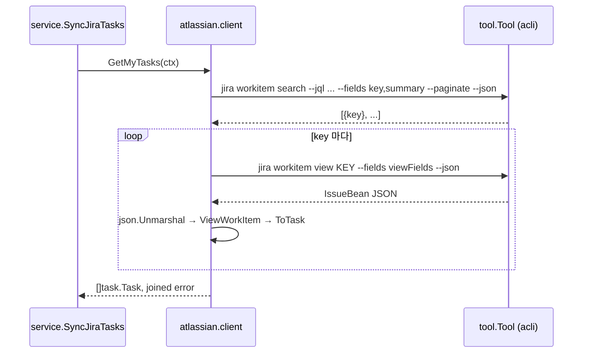

# acli → Jira Cloud REST API 대체 조사

## 구현 결과 (DEV-20)

- `internal/pkg/httputil` (`httputil.go`): `HTTPClient{Get, Post}` 가 ctx·헤더(Post 는 본문)로 요청하고 2xx 면 본문 `[]byte` 를 돌려준다. 2xx 외는 `ErrUnexpectedStatusCode`(`status=`, 512바이트로 자른 `body=`), 전송 실패·ctx 취소는 `ErrFailedToSendRequest`, 본문 읽기 실패는 `ErrFailedToReadResponseBody`. 요청 헤더 값은 에러에 넣지 않고, `http.Client.Timeout` 30초가 고정이다. mock 은 `mocks.MockHTTPClient`.
- `atlassian.NewClient(httpClient, siteURL, email, apiToken)` (`internal/adapter/atlassian/client.go:38`) 가 `strings.TrimRight(siteURL, "/") + "/rest/api/3/search/jql"` 와 Basic 인증 헤더를 만든다. `GetMyTasks` (`client.go:68`) 는 페이지 루프로 `jql`·`fields`(`searchFields()`)·`maxResults` 100·`nextPageToken` 을 보내고 `isLast` 또는 토큰 부재에서 멈춘다. 페이지 실패는 `nil, err`, 항목은 `json.RawMessage` 로 개별 디코딩해 `ErrFailedToParseWorkItem`/`ErrMissingWorkItemKey` (`index=`) 로 그 항목만 뺀다. `ErrGetMyTasksCanceled`·`ErrFailedToParseViewOutput`·`SearchItem`·`JiraSearchOption`/`JiraViewOption` 은 없어졌다.
- `config.Load` 는 `atlassian_site_url`·`atlassian_email`·`atlassian_api_token` 을 필수로 읽고(`ErrMissingConfigKey`, `key=`), site URL 이 http(s) 절대 URL 이 아니면 `ErrInvalidAtlassianSiteURL`. `acli_path`·`ErrFailedToFindACLI` 와 `internal/pkg/tool` 패키지는 제거됐다.
- 테스트 fixture: `testdata/search*.json` 은 지웠고, `client_test.go` 의 `page` 헬퍼가 `view_*.json` IssueBean 을 `issues[]` 에 담아 응답 페이지를 만든다.

## 이전 흐름 (acli, `75c7591` 기준 — DEV-20 에서 제거)

- `GetMyTasks` (`internal/adapter/atlassian/client.go:37`) 가 `searchKeys` (`client.go:65`) 로 key 목록을 얻고, key 마다 `viewWorkItem` (`client.go:94`) 을 호출한다. 두 단계인 이유는 acli `workitem search` 가 날짜 필드를 거부하기 때문이다(`internal/adapter/atlassian/jira.go:155-157` 주석).
- JQL `myTasksJQL = "assignee = currentUser() AND statusCategory != done"` (`jira.go:153`), 필드 `viewFields = "summary,description,status,duedate,parent,subtasks,issuelinks,customfield_10015"` (`jira.go:158`). `customfield_10015` 는 Jira Cloud 기본 "Start date" 필드다.
- 반환 규칙(현재): 검색 실패 → `nil, err`; ctx 취소(루프 중) → `nil, ErrGetMyTasksCanceled+ctx.Err()`; view 실패·파싱 실패 → 그 항목만 건너뛰고 에러 누적(`key=` 포함); key 없는 항목 → `ErrMissingWorkItemKey` (`index=`); `ToTask` 필드 에러 → task 는 포함하고 에러 누적. 테스트는 `internal/adapter/atlassian/client_test.go` 전체가 이 규칙을 고정한다.
- 의존: `atlassian.NewClient(tool tool.Tool)` (`client.go:29`), main 에서 `tool.NewTool(cfg.ACLIPath)` (`cmd/wharf/main.go:61`). `config.Load` 는 `exec.LookPath` 로 acli 를 해석하고 실패하면 `ErrFailedToFindACLI` (`internal/config/config.go:96-101`).
- `internal/pkg/tool` 의 사용처는 `atlassian` 패키지뿐이다(`cmd/wharf/main.go`, `internal/adapter/atlassian/{client,jira}.go` 와 그 테스트, mock `internal/pkg/mocks/tool_tool.go`, `.mockery.yml` 의 `tool.Tool` 항목). acli 를 걷어내면 패키지 전체가 고아가 된다.

## acli 출력 = REST v3 IssueBean

- `testdata/view_*.json` 은 `expand`, `id`, `key`, `fields`, `self` 가 `https://example.atlassian.net/rest/api/3/...` 를 가리키는 REST v3 IssueBean 그대로다(`internal/adapter/atlassian/testdata/view_todo.json`). 따라서 REST 응답의 `issues[]` 원소를 기존 `ViewWorkItem` (`jira.go:24`) 으로 그대로 디코딩할 수 있고, `ToTask`·`adfNode.markdown` (`internal/adapter/atlassian/adf.go`) 은 바뀌지 않는다.
- v3 여야 한다. v2 는 `description` 을 ADF 가 아닌 wiki markup 문자열로 준다.

## 대체 API: `POST /rest/api/3/search/jql` (Enhanced JQL search)

출처: 공식 OpenAPI 스펙 `https://dac-static.atlassian.com/cloud/jira/platform/swagger-v3.v3.json` (2026-10-27 확인), 문서 `https://developer.atlassian.com/cloud/jira/platform/rest/v3/api-group-issue-search/`.

- 요청 바디 `SearchAndReconcileRequestBean`:
  - `jql` (string) — bounded query 필수(`assignee = currentUser() ...` 는 bounded). `orderBy` 최대 7 필드.
  - `fields` (array<string>) — 기본은 `id` 만. `*all`, `*navigable`, 필드 ID 나열, `-` 접두어로 제외.
  - `maxResults` (integer) — 페이지당 최대 개수. 필드를 많이 요청하면 서버가 더 적게 줄 수 있다. `id`/`key` 만 요청할 때 최대(5000).
  - `nextPageToken` (string) — 첫 페이지는 null/생략, 이후는 직전 응답의 토큰.
  - `expand` (comma-delimited string), `properties` (≤5), `fieldsByKeys`, `reconcileIssues` (≤50 issue id, read-after-write 보정), `includeArchivedProjects`.
- 응답 `SearchAndReconcileResults`: `issues` (IssueBean 배열), `nextPageToken` (마지막 페이지면 null/생략, 7일 후 만료), `isLast` (boolean), `names`, `schema`, `warnings`(실험적). `total`·`startAt` 은 없다.
- 응답 코드: 200, 400(잘못된 요청/JQL), 401(인증 실패).
- 일관성: 최근 변경이 바로 보이지 않을 수 있다(eventual consistency).
- 같은 기능의 `GET /rest/api/3/search/jql` 은 쿼리 파라미터 버전(JQL 이 길면 POST 사용).
- 스코프: classic `read:jira-work`; granular(beta) `read:issue-details:jira`, `read:field.default-value:jira`, `read:field.option:jira`, `read:field:jira`, `read:group:jira`.
- 권한: Browse projects + (있으면) issue-level security.

### 쓰지 말 것
- `GET/POST /rest/api/3/search` (`startAt`/`total` 방식) 는 스펙에서 `deprecated: true`, "Endpoint is currently being removed" (changelog CHANGE-2046).

### 이번 범위에서 필요 없는 보조 API
- `GET /rest/api/3/issue/{issueIdOrKey}?fields=` — 단건 조회.
- `POST /rest/api/3/issue/bulkfetch` — key 목록 일괄 조회(기본 100, 조건 충족 시 1000).
- `GET /rest/api/3/myself` — 인증 확인(`read:jira-user`).
- `GET /rest/api/3/field` — "Start date" 커스텀 필드 ID 탐색.
- `POST /rest/api/3/search/approximate-count` — 근사 건수.

## 인증

- Basic auth: `Authorization: Basic base64("{email}:{api_token}")`, base URL `https://{site}.atlassian.net` (`https://developer.atlassian.com/cloud/jira/platform/basic-auth-for-rest-apis/`). DEV-20 이슈 본문도 같은 헤더(curl `printf '%s' "$EMAIL:$TOKEN" | base64`)를 명시한다.
- Scoped API token(Atlassian 권장)은 site URL 이 아니라 gateway `https://api.atlassian.com/ex/jira/{cloudId}` 로 보내고 인증은 같은 Basic 이다(`https://support.atlassian.com/atlassian-account/docs/manage-api-tokens-for-your-atlassian-account/`). 따라서 base URL 을 설정값 하나로 받고 그 뒤에 `/rest/api/3/...` 를 경로 결합하면 두 방식 모두 지원된다(경로 prefix `/ex/jira/{cloudId}` 를 보존해야 함).
- 토큰 만료: 기본 1년, 생성 시 1–365일.
- CAPTCHA 가 걸리면 REST 인증이 실패하고 응답에 `X-Seraph-LoginReason: AUTHENTICATION_DENIED` 가 붙는다.

## Rate limit (`https://developer.atlassian.com/cloud/jira/platform/rate-limiting/`)

- 초과 시 `429` + `Retry-After`(초). 일부 503 에도 `Retry-After`.
- 헤더: `X-RateLimit-Limit`, `X-RateLimit-Remaining`, `X-RateLimit-Reset`(429 일 때), `RateLimit-Reason`, beta 헤더들.
- API token(Basic) 트래픽은 새 points 기반 한도 대상이 아니고 기존 burst 한도만 적용된다. 사용자가 수동으로 한 번 실행하는 페이지 단위 검색은 burst 한도에 닿을 가능성이 낮다.

## 대체 시 바뀐 곳 (이전 위치 기준)

| 위치 | 현재 | REST 대체 후 |
| --- | --- | --- |
| `internal/adapter/atlassian/client.go` | `tool.Tool` 로 search + view N+1 | HTTP 클라이언트로 `POST /rest/api/3/search/jql` 페이지 루프 |
| `internal/adapter/atlassian/jira.go:150-196` | `myTasksJQL`, `viewFields`, `JiraSearchOption`, `JiraViewOption` | JQL·필드 상수만 남고 CLI 옵션 함수 제거 |
| `internal/adapter/atlassian/testdata/search*.json` | acli search 출력 | search/jql 응답 형태 fixture 로 교체 |
| `internal/config/config.go` | `acli_path`, `exec.LookPath`, `ErrFailedToFindACLI` | site URL·email·API token 키 |
| `config.example.toml` | `acli_path` | 새 키 문서화 |
| `cmd/wharf/main.go:61-67` | `tool.NewTool` → `atlassian.NewClient(acli)` | HTTP 클라이언트 → `atlassian.NewClient(...)` |
| `internal/pkg/tool/`, `internal/pkg/mocks/tool_tool.go`, `.mockery.yml` | acli 실행 | 고아 → 제거 |
| `internal/server/server.go:22-23` | shutdownTimeout 주석 "calling the CLI per item" | 문구 갱신 |
| `docs/design/wharf-domain-for-design.md:82` | "이슈마다 외부 CLI 를 호출함" | 문구 갱신 |
| `AGENTS.md:30` | "resolves the `acli` executable" | 문구 갱신 |
