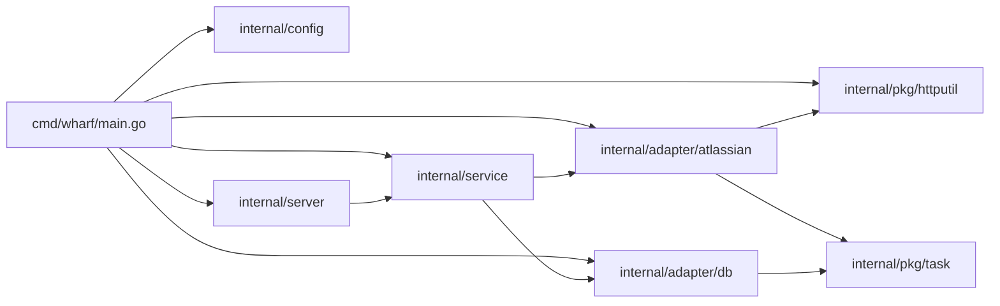

# server / service 계층 구조 조사

## 계층과 의존 방향

- 의존 간선은 `make deps-graph` (`Makefile:88`) 로 확인할 수 있다. `internal/...` 의 모듈 내부 import 간선만 출력한다. `server → service`, `service → atlassian·db` 만 있고 `server → adapter`, `service → server` 간선은 없다.

## main wiring (`cmd/wharf/main.go`)

- `run() (code int)` (`main.go:24`) 이 실제 본체이고 `main` 은 `os.Exit(run())` 만 한다. defer 로 DB `Close` 를 보장하면서 exit code 를 돌려주기 위한 형태다.
- 순서: `signal.NotifyContext(os.Interrupt, SIGTERM)` → `config.Path` → `config.Load` → `db.NewManager(cfg.DBPath, scripts.Migrations())` → `Connect` → `Migrate` → `atlassian.NewClient(httputil.NewHTTPClient(), cfg.AtlassianSiteURL, cfg.AtlassianEmail, cfg.AtlassianAPIToken)` (`main.go:61`) → `service.NewService` → `server.NewHandler` → `server.New` → `net.Listen(cfg.Addr)` → `Run`. 각 실패는 slog JSON 로그(stdout) 를 남기고 exit 1.
- main 은 환경변수를 직접 읽지 않는다. 설정값은 모두 `internal/config` 가 돌려준 `Config` 에서 온다.

## 설정 로딩 (`internal/config/config.go`)

- 설정은 TOML 파일 하나이고, 파서는 `github.com/BurntSushi/toml` 이다 (표준 라이브러리에 TOML 파서가 없다). 키 목록과 기본값은 저장소 루트의 `config.example.toml` 에 정리되어 있다.
- `Path()` (`config.go:51`): `WHARF_CONFIG` (`PathEnv`, `:15`) 가 있으면 그 값을, 없으면 `<os.UserConfigDir()>/wharf/config.toml` 을 돌려준다. `WHARF_CONFIG` 가 프로그램 전체에서 유일한 환경변수다.
- `Load(path)` (`:71`) 순서: `os.ReadFile` → `toml.Decode` → `MetaData.Undecoded()` 로 모르는 키가 있으면 실패 → Atlassian 필수 키 검사 → site URL 검증 → 기본값 채움.
  - 설정 파일이 없으면 실패한다. `atlassian_site_url`·`atlassian_email`·`atlassian_api_token` 은 필수라 빈 파일은 `ErrMissingConfigKey`(`key=` 에 빠진 키 이름) 로 실패한다. site URL 은 `http`/`https` scheme 과 host 가 있는 절대 URL 이어야 하고 아니면 `ErrInvalidAtlassianSiteURL` 이다. 에러 메시지에 토큰 값은 넣지 않는다.
  - `Config` (`:33`) 필드와 기본값: `addr` = `:8080`, `db_path` = `<os.UserConfigDir()>/wharf/wharf.db`, `atlassian_*` 세 키는 기본값 없음. 예전 `acli_path` 키는 이제 `ErrUnknownConfigKeys` 로 거부된다.
  - `db_path` 를 기본값으로 채울 때만 그 디렉터리를 `os.MkdirAll(..., 0o700)` 로 만든다. `WHARF_CONFIG` 로 설정 파일을 다른 곳에 두면 기본 DB 디렉터리가 없을 수 있고, SQLite 는 상위 디렉터리를 만들지 않기 때문이다. `db_path` 를 직접 지정하면 아무것도 만들지 않는다.
- sentinel 은 `"config: "` 접두어로 `ErrFailedToFindUserConfigDir`, `ErrFailedToReadConfigFile`, `ErrFailedToParseConfigFile`, `ErrUnknownConfigKeys`, `ErrFailedToCreateDBDir`, `ErrMissingConfigKey`, `ErrInvalidAtlassianSiteURL` 다 (`:22-30`). `UserConfigDir` 조회는 `Path` 와 `Load` 가 공유하는 `defaultFilePath` (`:60`) 한 곳에서만 실패한다.
- 파일 하나를 읽을 뿐 막히는 작업이 없어서 `Load` 는 `context.Context` 를 받지 않는다.
- 테스트 (`internal/config/config_test.go`) 는 `isolateUserConfigDir` 로 `HOME`·`XDG_CONFIG_HOME` 을 임시 디렉터리로 돌린다. 기본 DB 디렉터리 생성이 실제 사용자 설정 디렉터리에 닿지 않게 하려는 것이다. 유효한 최소 설정은 `atlassianKeys` 상수(세 키)다.

## server / service 구현

### service (`internal/service/service.go`)

- `Service` 인터페이스 (`service.go:29-36`): `SyncJiraTasks`(`POST /tasks/jira`), `ListTasks`, `GetTask(ctx, id) (TaskDetail, error)`, `CreateTask(ctx, task.Task) (string, error)`, `UpdateTask(ctx, task.Task) error`, `DeleteTask(ctx, id) error` 가 각 `/tasks` 라우트와 1:1 로 대응한다. 생성자 `NewService(jira atlassian.Client, db db.Manager) Service` (`:40`).
- sentinel (`service.go:15-26`, 접두어 `"service: "`): 입력 검증 `ErrEmptyTaskTitle`·`ErrUnknownTaskStatus`·`ErrEmptyRelatedTaskID`(공백뿐인 parent/child/linked ID, 빈 `ParentID` 는 parent 없음) (`normalize` `:167` 한 곳), `ErrTaskReferencesItself` (PUT 의 parent/children/linked 자기 참조), not-found 는 연산마다 `ErrTaskNotFound`(GetTask)·`ErrTaskToUpdateNotFound`(PUT 사전 확인)·`ErrLocalTaskToUpdateNotFound`(PUT 쓰기 시점)·`ErrTaskToDeleteNotFound`, `ErrTaskNotLocal`(local 이 아닌 task 의 PUT). db 의 not-found sentinel 을 `errors.Is` 로 보고 자기 sentinel 로 바꿔 server 가 adapter 를 import 하지 않게 한다.
- `GetTask` (`:71`) 는 `db.GetTask` 로 task 와 관계 ID 를 얻고, parent(있을 때만)·children·linked ID 를 한 번의 `ListTasksByIDs` 로 조회해(ID 가 없으면 조회하지 않음) 저장된 것만 `TaskDetail.Parent/Children/Linked` 에 ID 순서대로 담는다. `CreateTask` (`:105`) 는 `normalize`(빈 status → todo) 후 `CreateLocalTask`. `UpdateTask` (`:121`) 는 `normalize` → 자기 참조 검사 → `db.GetTask` 로 존재·origin 확인 → `db.UpdateLocalTask`. 읽기와 쓰기 사이에 삭제되거나 local 이 아니게 되면 `db.ErrLocalTaskToUpdateNotFound` 를 `ErrLocalTaskToUpdateNotFound` 로 바꿔 404 가 된다. `DeleteTask` (`:156`) 는 origin 과 관계없이 지운다.
- `SyncResult` (`:11`) 는 `Upserted int` 와 `Partial error` 를 갖는다. `Partial` 은 `GetMyTasks` 가 tasks 와 함께 돌려준 joined error 이고, 모두 성공하면 nil 이다.
- `SyncJiraTasks` (`:37`) 는 `GetMyTasks` 의 반환 규칙을 그대로 따른다. tasks 가 nil 이면 저장하지 않고 에러를 반환한다. non-nil 이면 에러가 있어도 반환된 tasks 를 전부 `UpsertTasks` 하고 Jira 에러는 `Partial` 로 넘긴다. `UpsertTasks` 실패는 그대로 반환한다.
- todo (DEV-18, `internal/service/todo.go`): `ListTodos(ctx, todo.Filter)`·`CreateTodo(ctx, todo.Todo) (int64, error)`·`UpdateTodo`·`DeleteTodo(ctx, int64)` 가 `Service` 에 추가되어 있다. `normalizeTodo` (`todo.go:90`) 가 공백 description/task_id(`ErrEmptyTodoDescription`·`ErrEmptyTodoTaskID`), `YYYY-MM-DD` 가 아닌 날짜(`ErrInvalidTodoDate`), `start_date > end_date`(`ErrTodoStartsAfterEnd`), 음수 position(`ErrNegativeTodoPosition`)을 막고 reminders 를 UTC·오름차순·중복 제거로 정규화한다. `ListTodos` 는 `today`·`end_date` 형식만 검사한다(`ErrInvalidTodoFilterDate`). db 의 sentinel 은 `ErrTaskOfNewTodoNotFound`·`ErrTaskOfUpdatedTodoNotFound`(400)·`ErrTodoToUpdateNotFound`·`ErrTodoToDeleteNotFound`(404)로 바꾼다.
- service 는 로그를 남기지 않는다. 로그는 server 쪽 handler 가 request id 와 함께 남긴다.

### route (`internal/server/route.go`)

- `NewHandler(svc, logger) http.Handler` (`route.go:29`) 가 표준 `ServeMux` method pattern 으로 `GET /healthz`, `POST /tasks/jira`, `GET /tasks`, `POST /tasks`, `GET /tasks/{id}`, `PUT /tasks/{id}`, `DELETE /tasks/{id}` 를 등록한다. `GET /tasks/jira` 는 `GET /tasks/{id}` 에 매칭되어 405 가 아니라 service 의 404 가 된다. 서버 객체 생성과 분리되어 있어 `MockService` + `httptest` 만으로 테스트할 수 있다.
- `healthz` 는 200 `{"status":"ok"}`.
- `syncJiraTasks` (`:44`) 는 service 에러를 모두 500 으로 바꾼다 (`writeInternalError` `util.go:47`). 주석과 달리 `writeInternalError` 는 `err.Error()` 를 응답 본문에 싣는다(테스트가 이 동작을 고정). 성공 시 200 `{"upserted":N,"partial":bool}` 이며, `Partial` 이 있으면 Warn 로그로 남긴다.
- request id 는 요청 헤더 `X-Request-ID` 에서 읽는다. 그래서 handler 로그의 request id 는 `Server` 의 request-id 미들웨어가 먼저 돌았다는 전제에 의존한다.
- task 라우트의 에러는 `writeError` (`util.go:32`) 한 곳에서 `errorStatuses` 표(`util.go:14`)로 상태를 정한다: `ErrFailedToDecodeTaskRequest`·`ErrTaskRequestHasTrailingData`·`ErrEmptyTaskTitle`·`ErrUnknownTaskStatus`·`ErrEmptyRelatedTaskID`·`ErrTaskReferencesItself` 400, `ErrTaskRequestTooLarge` 413, not-found 4종(`ErrTaskNotFound`·`ErrTaskToUpdateNotFound`·`ErrLocalTaskToUpdateNotFound`·`ErrTaskToDeleteNotFound`) 404, `ErrTaskNotLocal` 409. 4xx 는 `{"error":err.Error()}` 와 Info 로그, 그 외는 Error 로그 + `writeInternalError`.
- 요청 본문 디코딩은 `decodeTask` (`route.go:168`): `http.MaxBytesReader`(1 MiB) + `DisallowUnknownFields` 로 `taskRequest` 를 읽고, 1 MiB 를 넘으면(`*http.MaxBytesError`) `ErrTaskRequestTooLarge` 로 413, 그 외 실패는 `ErrFailedToDecodeTaskRequest` 와 json 에러의 join 이다. `id`·`originated` 는 모르는 필드라 400. 날짜는 `time.Time` 의 RFC3339 디코딩을 쓴다. 첫 JSON 값 뒤에 공백 외의 데이터(두 번째 객체·쓰레기·여분 `}`)가 있으면 두 번째 `Decode` 가 `io.EOF` 가 아니므로 `ErrTaskRequestHasTrailingData` 로 400 이다.
- 응답은 `internal/server/model.go` 의 `taskSummary`(관계 없음, description 은 `toSummary` `route.go:204` 이 100 rune 초과 시 앞 100 rune + `…`), `taskListResponse`, `taskDetailResponse`(전체 description, `parent_id` null 가능, ID 목록·summary 목록은 항상 배열), `createTaskResponse`. POST 는 201 + `Location: /tasks/{id}`, PUT·DELETE 는 204.

- todo 라우트 (DEV-18, `internal/server/todo.go`): `GET /todos`(쿼리 `task_id`·`today`·`end_date`·`is_done`, 빈 값은 필터 없음, `is_done` 은 `strconv.ParseBool` 실패 시 `ErrInvalidTodoIsDoneFilter` 400), `POST /todos`(201 `{"id":N}`, `Location` 없음), `PUT /todos/{id}`·`DELETE /todos/{id}`(204). 경로 id 가 정수가 아니면 `ErrTodoIDNotInteger` 로 404. `decodeTodo` (`todo.go:135`) 는 `decodeTask` 와 같은 규칙에 todo 전용 sentinel(`ErrFailedToDecodeTodoRequest`·`ErrTodoRequestHasTrailingData`·`ErrTodoRequestTooLarge`)을 쓰고, 날짜에 빈 문자열을 보내면 `ErrEmptyTodoRequestDate` 400 이다. 응답 `todoResponse`(`model.go`)는 날짜 없으면 null, reminders 는 항상 배열. todo sentinel 도 같은 `errorStatuses` 표에 있다.

### server (`internal/server/server.go`)

- `New(handler, logger) *Server` (`server.go:35`) 는 `*http.Server` 를 감싸고 미들웨어를 바깥부터 request-id → request-logger → recover 순으로 씌운다. `ReadHeaderTimeout` 은 10초이고, 동기화 요청이 Jira REST 검색을 여러 페이지 호출해 오래 걸릴 수 있으므로 `WriteTimeout` 은 두지 않는다.
- `withRequestID` (`:68`): 들어온 `X-Request-ID` 를 재사용하고, 없으면 `crypto/rand.Text()` 로 만들어 요청을 Clone 한 뒤 헤더에 넣는다. 응답 헤더에도 같은 값을 넣는다.
- `withRequestLog` (`:83`): `statusRecorder` (`:129`) 로 상태 코드를 잡아 method, path, status, request_id 를 Info 로그로 남긴다. `statusRecorder.Unwrap` 이 있어 `http.ResponseController` 가 원래 writer 에 닿는다.
- `withRecover` (`:101`): panic 을 500 응답과 Error 로그(stack 포함) 로 바꾼다. `http.ErrAbortHandler` 는 다시 panic 해서 net/http 가 연결을 끊게 둔다. 이 경우 request-logger 의 로그 줄까지 실행되지 않는다.
- `Run(ctx, ln net.Listener) error` (`:45`): goroutine 에서 `Serve(ln)` 을 돌리고, Serve 가 먼저 끝나면 `ErrFailedToServe` 를 반환한다. ctx 가 끝나면 `context.WithoutCancel(ctx)` 에 `shutdownTimeout`(30초) 을 건 컨텍스트로 `Shutdown` 하고 nil 을 반환한다. timeout 을 넘기면 `ErrFailedToShutdown` 이다. listener 를 인자로 받는 것은 테스트에서 `:0` 을 쓰기 위해서다.
- sentinel 은 `ErrFailedToServe`, `ErrFailedToShutdown` 두 개로, 접두어는 `"server: "` 다.

## adapter 계약

### db.Manager (`internal/adapter/db/client.go`)

- 인터페이스 `client.go:45-61`: `UpsertTasks(ctx, []task.Task) error`, `CreateLocalTask(ctx, task.Task) (string, error)`, `ListTasks`, `ListTasksByIDs(ctx, ids)`, `GetTask(ctx, id) (task.Task, error)`(관계 ID 포함, 없으면 `ErrTaskNotFound`), `UpdateLocalTask(ctx, task.Task) error`(없거나 local 이 아니면 `ErrLocalTaskToUpdateNotFound`), `DeleteTask(ctx, id) error`(없으면 `ErrTaskToDeleteNotFound`), `Connect`, `Migrate`, `Close`. 인자는 도메인 타입 `task.Task` 이므로 호출하는 service 는 sqlc 생성 모델(`internal/adapter/db/models.go` 의 `Task`·`TaskHierarchy`·`TaskLink`·`Counter`) 을 알 필요가 없다.
- todo 메서드 (DEV-18, `internal/adapter/db/todo.go`): `CreateTodo(ctx, todo.Todo) (int64, error)`, `ListTodos(ctx, todo.Filter) ([]todo.Todo, error)`, `UpdateTodo(ctx, todo.Todo) error`, `DeleteTodo(ctx, int64) error`. 쓰기는 모두 `inTx` 안에서 쓰기 문장으로 시작한다(`CreateTodo` 는 `INSERT ... SELECT ... WHERE EXISTS (task)` 의 no-rows 로 없는 task 판별, `UpdateTodo`·`DeleteTodo` 는 `:execrows`). position 배치는 `placeTodo` (`todo.go:229`, 개수 → 밀기 → 연결 행 삽입), 제거는 `unlinkTodo` (`:253`, `DELETE ... RETURNING` → 당기기)가 공유한다. `DeleteTask` 는 같은 트랜잭션에서 그 task 의 reminder·todo·연결 행을 지운다(`client.go:280` 부근). 도메인 타입은 `internal/pkg/todo` 의 `todo.Todo`(날짜는 `"YYYY-MM-DD"` 문자열, 빈 문자열은 없음, `Position *int`)와 `todo.Filter`.
- sentinel `client.go:16-40`: `ErrNotConnected`, `ErrFailedToBeginTx`, `ErrFailedToUpsertTask`, `ErrFailedToDeleteTaskParent`, `ErrFailedToStoreTaskParent`, `ErrFailedToStoreTaskChild`, `ErrFailedToDeleteTaskLinks`, `ErrFailedToStoreTaskLink`, `ErrFailedToIncrementLocalTaskCounter`, `ErrFailedToCommitTx`, 그리고 DEV-16 의 읽기·수정·삭제용(`ErrFailedToListTasks`, `ErrFailedToListTasksByIDs`, `ErrTaskNotFound`, `ErrFailedToGetTask`, `ErrFailedToListTaskChildren`, `ErrFailedToListTaskLinks`, `ErrFailedToUpdateLocalTask`, `ErrLocalTaskToUpdateNotFound`, `ErrFailedToDeleteTaskChildren`, `ErrFailedToDeleteLocalTaskLinks`, `ErrFailedToDeleteTask`, `ErrTaskToDeleteNotFound`, `ErrFailedToDeleteTaskHierarchies`, `ErrFailedToDeleteTaskLinksOf`). 관계 쓰기 실패는 `fmt.Errorf("%w: id=%s, ...", errors.Join(ErrX, err), ...)` 로 task ID 와 상대 ID 를 붙인다.
- 트랜잭션은 `inTx` (`client.go:268`) 한 곳에서 `BeginTx` → `queries.WithTx(tx)` → fn → `Commit` 한다. defer Rollback 이라 fn 이 실패하면 아무것도 저장되지 않는다. begin/commit sentinel 은 두 메서드가 공유한다(return site 가 `inTx` 하나).
- `UpsertTasks` `client.go:91`: `checkConnected` → 빈 목록 no-op → `inTx` 안에서 task 마다 `storeTask` (`client.go:289`, upsert 후 `storeRelations` `:299`). 같은 ID 는 `ON CONFLICT (id) DO UPDATE` 로 덮어쓴다.
- `storeTask` 의 관계 소유 규칙:
  - parent 는 task 소유: `task_hierarchies` 의 `child_id = T` 행을 지우고 `ParentID` 가 있으면 다시 넣는다. 단 local 이 아닌 T 가 parent 를 선언하지 않으면 local parent(`tasks.originated = 'local'`) 행은 남긴다(`DeleteTaskNonLocalParent`).
  - children 은 추가·재지정만: `(child, T)` 를 `ON CONFLICT(child_id) DO UPDATE` 로 넣는다. 목록에 없는 기존 children 행은 남는다(Jira Epic 은 Story 를 subtasks 로 나열하지 않으므로).
  - linked 는 task 소유: `task_links` 의 `task_id = T` 행을 지우고 `LinkedIDs` 를 `ON CONFLICT DO NOTHING` 으로 넣는다. 다른 task 가 T 로 선언한 행은 건드리지 않는다.
- `CreateLocalTask` `client.go:115`: 같은 트랜잭션에서 `IncrementCounter("local_task")` (첫 문장이 쓰기라 SQLITE_BUSY 회피 규칙을 지킨다) → `task.NewID(OriginLocal, task.LocalKey(n))` 로 `local-WHF-001` 형식 ID 생성 → `Originated = local` 로 `storeTask` → ID 반환. 입력의 `ID`·`Originated` 는 무시한다. 실패하면 카운터 증가도 롤백되어 번호가 소모되지 않는다. `service.CreateTask` 가 호출한다.
- `UpdateLocalTask` `client.go:205`: 트랜잭션 첫 문장 `UPDATE ... WHERE id = ? AND originated = 'local'` 의 영향 행 수로 존재를 판별 → `parent_id = T` 행 전부 삭제(children 전체 교체) → `DeleteTaskLinksOf` 로 양방향 links 삭제(GetTask 가 양방향 합집합으로 읽으므로 PUT 의 `linked_ids` 도 양방향 전체 교체) → `storeRelations`. `DeleteTask` `client.go:240`: `DELETE FROM tasks` 영향 행 수로 판별 → `task_hierarchies` 의 child·parent 양쪽, `task_links` 의 선언자·대상 양쪽 행 삭제.
- 읽기 `ListTasks` `:141`·`ListTasksByIDs` `:156`·`GetTask` `:173` 는 트랜잭션 없이 실행하고 `fromTask` (`:358`) 로 sqlc 모델을 `task.Task` 로 바꾼다(NULL 날짜는 nil).
- `task.Task` → `UpsertTaskParams` 변환은 `toUpsertTaskParams` (`client.go:337`) 가 맡는다. `*time.Time` 은 `toNullTime` (`:378`) 으로 nil 이면 NULL 이다. `Origin`/`Status` 는 `string(...)` 변환이다.
- `scripts/queries.sql` 의 쿼리 목록은 [task-id-and-relations](./task-id-and-relations.md) 에 정리되어 있다.
- `checkConnected` `client.go:386` 는 모든 비관리 메서드의 첫 줄이다.
- 마이그레이션 FS 는 `scripts.Migrations()` (`scripts/migrations.go:13`) 로 얻는다.

### atlassian.Client (`internal/adapter/atlassian/client.go`)

- 인터페이스 `client.go:25-27`: `GetMyTasks(ctx) ([]task.Task, error)`. 생성자 `NewClient(httpClient httputil.HTTPClient, siteURL, email, apiToken string) Client` (`client.go:38`). site URL 끝의 `/` 를 떼고 `/rest/api/3/search/jql` 을 붙이며(경로 prefix 보존), `Authorization: Basic base64(email:token)`·`Accept`·`Content-Type: application/json` 헤더를 미리 만든다.
- 반환 규칙 (`GetMyTasks` `client.go:68`):
  - 어떤 페이지든 요청 실패(`httputil` 에러 그대로) 또는 응답 파싱 실패(`ErrFailedToParseSearchOutput`) → `nil, err`. 앞 페이지 결과와 항목 에러는 버린다. ctx 취소는 `httputil.ErrFailedToSendRequest` 와 `context.Canceled` 를 함께 담는다.
  - 항목은 `json.RawMessage` 로 받아 개별 디코딩한다. 디코딩 실패 → `ErrFailedToParseWorkItem` + `index=`(페이지를 넘어 이어지는 전역 순번), key 없음(`null` 포함) → `ErrMissingWorkItemKey` + `index=`. 둘 다 그 항목만 뺀다.
  - 변환(`ToTask`) 에러가 있어도 task 는 결과에 포함된다. `ToTask` 는 잘못된 필드를 빈 값으로 두고 에러를 join 한다 (`internal/adapter/atlassian/jira.go:51`). task ID 와 관계 ID 는 `jira-{key}` 이고, 에러 메시지의 `key=` 는 raw key 다.
  - 모든 페이지가 성공하면 `tasks` (항상 non-nil, 결과 없음이면 빈 슬라이스) 와 `errors.Join(errs...)` 를 함께 반환한다. `isLast` 가 true 이거나 `nextPageToken` 이 비면 멈춘다. 응답 토큰이 방금 보낸 토큰과 같으면 `ErrRepeatedSearchPageToken`, 100 페이지(`maxSearchPages`)를 넘기면 `ErrTooManySearchPages` 로 `nil` 과 에러를 반환한다.
  - 즉 "tasks 가 nil 이면 전체 실패, non-nil 이면 부분 결과(에러가 있을 수 있음)" 가 규칙이다.
- 요청 바디는 `jql`(`myTasksJQL`), `fields`(`searchFields()` 8개, `jira.go:162`), `maxResults` 100, 두 번째 페이지부터 `nextPageToken`.

### httputil.HTTPClient (`internal/pkg/httputil/httputil.go`)

- `Get(ctx, url, header)` / `Post(ctx, url, header, body)` 가 `[]byte` 응답 본문을 돌려준다. 생성자 `NewHTTPClient() HTTPClient`, `net/http` 와 고정 timeout 30초. redirect 는 따라가지 않는다(`CheckRedirect` 가 `http.ErrUseLastResponse`; 같은 host redirect 에 Authorization 이 재전송되는 것을 막음) — 3xx 는 `ErrUnexpectedStatusCode`.
- sentinel: `ErrFailedToCreateRequest`, `ErrFailedToSendRequest`(연결 실패·ctx 취소·timeout), `ErrFailedToReadResponseBody`, `ErrUnexpectedStatusCode`(2xx 외, 메시지에 `status=` 와 최대 512바이트 `body=`), `ErrResponseBodyTooLarge`(2xx 본문 32 MiB 초과). 요청 헤더 값과 URL userinfo 는 에러에 넣지 않는다. 재시도는 없다.

### 도메인 타입 (`internal/pkg/task`)

- `task.Task` `internal/pkg/task/task.go:5-16`: 날짜는 `*time.Time`, ID 목록은 `[]string`, `Originated task.Origin`, `Status task.Status`.
- ID 는 `{originated}-{key}` 이며 `task.NewID` (`internal/pkg/task/id.go:10`) 로 만든다. local key 는 `task.LocalKey(n)` (`id.go:16`) 가 `WHF-%03d` 로 만든다.
- `Origin` / `Status` 는 `string` 기반 타입이며 상수는 untyped string 이다 (`origin.go:5-10`, `status.go:5-10`).

## db 테스트의 저장 확인 방식

- 쓰기 테스트는 Manager 의 읽기 메서드 대신 파일 DB 에 별도 연결을 열어 직접 SQL 로 확인한다(읽기 메서드 자체의 테스트는 `TestListTasks`·`TestGetTask` 등).
- `internal/adapter/db/client_test.go`:
  - `newManager` (`:21`) 는 `:memory:` DB 를 쓴다. 단일 연결(`SetMaxOpenConns(1)`, `client_management.go:68`) 이라 다른 연결로 같은 in-memory DB 를 읽을 수 없다. 저장 내용을 확인하지 않는 테스트만 이것을 쓴다.
  - `newFileManager` (`:42`) 는 파일 DB 와 경로를 반환한다. `open` (`:145`) 이 그 경로로 별도 `*sql.DB` 를 열고, `read` (`:90`) 는 tasks 한 행의 컬럼을 `readTask` 로 읽으며, `requireExists` (`:107`) 는 `SELECT EXISTS (...)` 로 존재 여부를 확인한다. `relations` (`:120`) 는 `task_hierarchies` 를 `child<parent`, `task_links` 를 `task>linked` 문자열로 모아 정렬해 돌려준다.
  - 실패 유도는 `projectMigrationsWith` (`:57`) 로 `RAISE(ABORT)` trigger 마이그레이션을 덧붙여 한다(`TestUpsertTasksRollsBackOnFailure` 는 쓰기 지점마다 trigger 하나).
  - `newTask` (`:155`) 는 `task.Task` 를 만든다.
  - todo 테스트는 `internal/adapter/db/todo_test.go` 에 있고 `placements`(`task_todos` 를 `task:position:todo` 로)·`stored`(todos·todo_reminders 의 id)·`texts` 헬퍼로 직접 SQL 확인한다.
- `internal/adapter/db/client_management_test.go` 도 재연결 후 데이터 유지 등을 같은 `newFileManager`·`requireExists` 조합으로 확인한다. `TestMethodsRequireConnection` (`:234`) 은 연결 전·종료 후의 `UpsertTasks`, `CreateLocalTask`, 읽기·수정·삭제 메서드, `Migrate` 가 `ErrNotConnected` 인지 본다.

## mockery

- `.mockery.yml`: template `testify`, `dir: internal/pkg/mocks`, `filename: "{{.SrcPackageName}}_{{.InterfaceName | lower}}.go"`, `structname: "{{.Mock}}{{.InterfaceName}}"`. 등록된 인터페이스는 `db.Manager`, `httputil.HTTPClient`, `atlassian.Client`, `service.Service` 이다.
- 따라서 `service.Service` → `internal/pkg/mocks/service_service.go` / `MockService`, `atlassian.Client` → `internal/pkg/mocks/atlassian_client.go` / `MockClient`, `db.Manager` → `db_manager.go` / `MockManager` 가 된다. service 테스트는 `MockClient`·`MockManager`, route 테스트는 `MockService` 를 쓴다.
- 테스트는 `mocks.NewMockHTTPClient(t)` + `m.EXPECT().Post(ctx, url, header, body).Return(...).Once()` 형태로 쓴다 (`internal/adapter/atlassian/client_test.go` 의 `TestGetMyTasks`). `httputil.HTTPClient` → `httputil_httpclient.go` / `MockHTTPClient`. 기대를 등록하지 않은 메서드가 호출되면 mock 이 테스트를 실패시키므로, "호출되지 않아야 한다" 는 기대를 등록하지 않는 것으로 표현한다.

## 코드 스타일 관례

- lint (`.golangci.yml`): `wsl_v5` 활성화, `after-block` (블록 `}` 뒤 빈 줄), `branch-max-lines: 2`. formatter `gofumpt`, `golines` (`max-len: 120`).
- 에러: sentinel 은 파일 상단 `var (...)` 블록에 모으고 메시지는 `"<package>: ..."`. 표준/서드파티 에러는 `errors.Join(ErrX, err)`, 모듈 내부 에러는 그대로 반환하되 맥락이 필요하면 `fmt.Errorf("%w: key=%s", err, key)`.
- 생성자는 인터페이스를 반환하고 구현은 unexported struct (`atlassian.NewClient`, `db.NewManager`, `httputil.NewHTTPClient`).
- 문서 주석은 exported 함수·메서드에 이름으로 시작. unexported 는 의도가 불분명할 때만.
- 테스트: `<package>_test` 외부 패키지, `require` 위주, `t.Context()` 또는 `context.Background()`, 헬퍼는 `t.Helper()` 로 시작.

## AGENTS.md 의 계층 서술

- `AGENTS.md:30` — Architecture Overview 의 `internal/config/` 항목 (TOML 설정 로딩, `config.example.toml`).
- `AGENTS.md:31` — Architecture Overview 의 `internal/server/` 항목 (HTTP server, middleware, handlers).
- `AGENTS.md:43` — Code Conventions 의 layering `server` → `service` → `adapter`.
- `AGENTS.md:69` — Boundaries 의 설정 규칙: `internal/config` 로 읽고, 환경변수는 `WHARF_CONFIG` 하나뿐이다.
- `AGENTS.md:70` — Boundaries 의 `NEVER import internal/server from internal/service or internal/adapter`.
- `AGENTS.md:29` 의 "routes" 는 일반 명사로, 특정 패키지를 가리키지 않는다.
