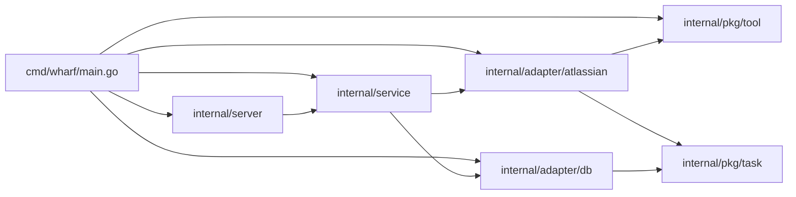

# server / service 계층 구조 조사

## 계층과 의존 방향

- 현재 `cmd/wharf/main.go:5` 는 `fmt.Println("Hello world")` 뿐이며 wiring 이 전혀 없다.
- 의존 간선은 `make deps-graph` (`Makefile:88`) 로 확인할 수 있다. `internal/...` 의 모듈 내부 import 간선만 출력한다.

## 뼈대 파일의 TODO

- `internal/server/route.go:3-7` — route 정의, `GET /healthz` 포함, 기본적인 request body 검사, 검사 후 service 의 1:1 대응 함수 호출, service 반환값·에러를 HTTP status code 와 함께 반환.
- `internal/server/server.go:3-6` — 기본 서버 구조체, 실행과 graceful shutdown, 기본 미들웨어(recover, request-id, request-logger), route 정의는 서버 객체 생성과 분리(테스트 용이성).
- `internal/service/service.go:3` — adapter 함수를 호출해 비즈니스 로직 수행.
- 세 파일 모두 `package` 선언과 TODO 주석만 있다.

## adapter 계약

### db.Manager (`internal/adapter/db/client.go`)

- 인터페이스 `client.go:21-32`: `CreateTasks(ctx, []Task) error`, `ExistsTask(ctx, id) (bool, error)`, `Connect`, `Migrate`, `Close`. 여기의 `Task` 는 sqlc 생성 모델 `db.Task` (`internal/adapter/db/models.go:17-28`) 로, 날짜는 `sql.NullTime`, ID 목록은 JSON 배열 문자열(`ChildrenIds`, `LinkedIds`) 이다.
- sentinel `client.go:13-19`: `ErrNotConnected`, `ErrFailedToBeginTx`, `ErrFailedToCreateTask`, `ErrFailedToCommitTx`, `ErrFailedToCheckTaskExists`. `ErrFailedToCheckTaskExists` 는 `ExistsTask` 에서만 쓰인다.
- `CreateTasks` `client.go:53-86`: `checkConnected` → 빈 목록 no-op → `BeginTx` → `queries.WithTx(tx)` 로 단건 `UpsertTask` 반복 → `Commit`. defer Rollback. ID 목록 빈 문자열은 `orEmptyJSONArray` (`client.go:110-116`) 로 `"[]"` 가 된다. 실패는 `fmt.Errorf("%w: id=%s", errors.Join(ErrFailedToCreateTask, err), task.ID)` 로 감싼다.
- 생성 params 는 `UpsertTaskParams(task)` 타입 변환으로 만든다 (`client.go:76`). `UpsertTaskParams` 는 `internal/adapter/db/queries.sql.go:62` 에 생성되며 `db.Task` 와 필드가 같다.
- `ExistsTask` `client.go:88-100`, 쿼리 `scripts/queries.sql:18-19`, 생성 코드 `internal/adapter/db/queries.sql.go:33-37`, mock `internal/pkg/mocks/db_manager.go:203`, `:236`.
- `checkConnected` `client.go:102-108` 는 모든 비관리 메서드의 첫 줄이다.
- 마이그레이션 FS 는 `scripts.Migrations()` (`scripts/migrations.go:13`) 로 얻는다.

### atlassian.Client (`internal/adapter/atlassian/client.go`)

- 인터페이스 `client.go:20-22`: `GetMyTasks(ctx) ([]task.Task, error)`. 생성자 `NewClient(tool tool.Tool) Client` (`client.go:29`).
- 반환 규칙 (`client.go:36-61`):
  - 검색 자체 실패(`searchKeys` 에러) → `nil, err` (`client.go:39`).
  - 루프 중 ctx 취소 → `nil, errors.Join(..., ErrGetMyTasksCanceled, ctx.Err())` (`client.go:46`).
  - 개별 항목 view 실패 → 해당 항목은 건너뛰고 에러만 누적 (`client.go:49-53`).
  - 변환(`ToTask`) 에러가 있어도 task 는 결과에 포함된다 (`client.go:55-57`). `ToTask` 는 잘못된 필드를 빈 값으로 두고 에러를 join 한다 (`internal/adapter/atlassian/jira.go:53-108`).
  - 그 외에는 `tasks` (항상 non-nil, `make(..., 0, len(keys))` `client.go:42`) 와 `errors.Join(errs...)` 를 함께 반환한다.
  - 즉 "tasks 가 nil 이면 전체 실패, non-nil 이면 부분 결과(에러가 있을 수 있음)" 가 현재 코드의 규칙이다. view 실패와 검색 실행 실패는 둘 다 `tool.ErrFailedToExecuteCmd` 를 포함할 수 있어 `errors.Is` 로는 구분되지 않는다.
- CLI 옵션: `JiraSearchOption` (`jira.go:165`), `JiraViewOption` (`jira.go:183`) 의 `Cmd` 는 `"jira"`, 실행 파일은 Atlassian CLI(`acli`) 를 전제로 한다.

### tool.Tool (`internal/pkg/tool/tool.go`)

- `NewTool(execCmd string) (Tool, error)` (`tool.go:41-57`): `filepath.Abs` 후 `os.Stat` 으로 실행 파일 여부를 검사한다. PATH 탐색을 하지 않으므로 `"acli"` 같은 bare name 은 현재 디렉터리 기준 경로가 된다.
- `Run` (`tool.go:61-80`): ctx 가 끝나면 프로세스를 kill 한다. `RunOption.Cwd` 가 빈 문자열이면 `filepath.Abs("")` 로 현재 디렉터리가 된다.

### 도메인 타입 (`internal/pkg/task`)

- `task.Task` `internal/pkg/task/task.go:5-16`: 날짜는 `*time.Time`, ID 목록은 `[]string`, `Originated task.Origin`, `Status task.Status`.
- `Origin` / `Status` 는 `string` 기반 타입이며 상수는 untyped string 이다 (`origin.go:5-10`, `status.go:5-10`).

## ExistsTask / CreateTasks 를 쓰는 테스트

- `internal/adapter/db/client_test.go`:
  - `newManager` (`:19`) 는 `:memory:` DB 를 쓴다. 단일 연결(`SetMaxOpenConns(1)`, `client_management.go:68`) 이라 다른 연결로 같은 in-memory DB 를 읽을 수 없다.
  - `newFileManager` (`:41`) 는 파일 DB 와 경로를 반환하고, `read` (`:89-103`) 가 별도 연결로 행을 읽는다.
  - `requireExists` (`:105-111`) 가 `ExistsTask` 를 쓴다. 사용처: `:128-130`, `:158`, `:205-206`, `:217`. `TestExistsTaskFailure` (`:220`) 는 `ExistsTask` 전용이다.
  - `newTask` (`:114`) 는 `db.Task` 를 만든다. `CreateTasks` 호출은 `:126` 이후 테스트 전반.
- `internal/adapter/db/client_management_test.go`: `CreateTasks`·`requireExists` 사용 `:51`, `:59`, `:66-67`, `:228-230`, `:260-261`, `:266-270`. `TestMethodsRequireConnection` 은 `:243` 에서 `CreateTasks`, `:247` 에서 `ExistsTask` 의 `ErrNotConnected` 를 확인한다.

## mockery

- `.mockery.yml:1-12`: template `testify`, `dir: internal/pkg/mocks`, `filename: "{{.SrcPackageName}}_{{.InterfaceName | lower}}.go"`, `structname: "{{.Mock}}{{.InterfaceName}}"`. 현재 등록은 `db.Manager`, `tool.Tool` 뿐이다.
- 따라서 `service.Service` → `internal/pkg/mocks/service_service.go` / `MockService`, `atlassian.Client` → `internal/pkg/mocks/atlassian_client.go` / `MockClient` 가 된다.
- 테스트는 `mocks.NewMockTool(t)` + `m.EXPECT().Run(...).Return(...).Once()` 형태로 쓴다 (`internal/adapter/atlassian/client_test.go:66-71`).

## 코드 스타일 관례

- lint (`.golangci.yml`): `wsl_v5` 활성화, `after-block` (블록 `}` 뒤 빈 줄), `branch-max-lines: 2`. formatter `gofumpt`, `golines` (`max-len: 120`).
- 에러: sentinel 은 파일 상단 `var (...)` 블록에 모으고 메시지는 `"<package>: ..."`. 표준/서드파티 에러는 `errors.Join(ErrX, err)`, 모듈 내부 에러는 그대로 반환하되 맥락이 필요하면 `fmt.Errorf("%w: key=%s", err, key)`.
- 생성자는 인터페이스를 반환하고 구현은 unexported struct (`atlassian.NewClient`, `db.NewManager`, `tool.NewTool`).
- 문서 주석은 exported 함수·메서드에 이름으로 시작. unexported 는 의도가 불분명할 때만.
- 테스트: `<package>_test` 외부 패키지, `require` 위주, `t.Context()` 또는 `context.Background()`, 헬퍼는 `t.Helper()` 로 시작.

## AGENTS.md 의 internal/route 언급

- `AGENTS.md:30` — Architecture Overview 의 `internal/route/` 항목.
- `AGENTS.md:42` — Code Conventions 의 layering `route` → `service` → `adapter`.
- `AGENTS.md:69` — Boundaries 의 `NEVER import internal/route ...`.
- `AGENTS.md:29` 의 "routes" 는 일반 명사라 대상이 아니다.
