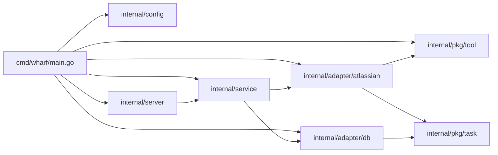

# server / service 계층 구조 조사

## 계층과 의존 방향

- 의존 간선은 `make deps-graph` (`Makefile:88`) 로 확인할 수 있다. `internal/...` 의 모듈 내부 import 간선만 출력한다. `server → service`, `service → atlassian·db` 만 있고 `server → adapter`, `service → server` 간선은 없다.

## main wiring (`cmd/wharf/main.go`)

- `run() (code int)` (`main.go:24`) 이 실제 본체이고 `main` 은 `os.Exit(run())` 만 한다. defer 로 DB `Close` 를 보장하면서 exit code 를 돌려주기 위한 형태다.
- 순서: `signal.NotifyContext(os.Interrupt, SIGTERM)` → `config.Path` → `config.Load` → `db.NewManager(cfg.DBPath, scripts.Migrations())` → `Connect` → `Migrate` → `tool.NewTool(cfg.ACLIPath)` → `atlassian.NewClient` → `service.NewService` → `server.NewHandler` → `server.New` → `net.Listen(cfg.Addr)` → `Run`. 각 실패는 slog JSON 로그(stdout) 를 남기고 exit 1.
- main 은 환경변수를 직접 읽지 않는다. 설정값은 모두 `internal/config` 가 돌려준 `Config` 에서 온다.

## 설정 로딩 (`internal/config/config.go`)

- 설정은 TOML 파일 하나이고, 파서는 `github.com/BurntSushi/toml` 이다 (표준 라이브러리에 TOML 파서가 없다). 키 목록과 기본값은 저장소 루트의 `config.example.toml` 에 정리되어 있다.
- `Path()` (`config.go:45`): `WHARF_CONFIG` (`PathEnv`, `:15`) 가 있으면 그 값을, 없으면 `<os.UserConfigDir()>/wharf/config.toml` 을 돌려준다. `WHARF_CONFIG` 가 프로그램 전체에서 유일한 환경변수다.
- `Load(path)` (`:67`) 순서: `os.ReadFile` → `toml.Decode` → `MetaData.Undecoded()` 로 모르는 키가 있으면 실패 → 기본값 채움 → `exec.LookPath` 로 acli 해석.
  - 설정 파일이 없으면 실패한다. 모든 키가 선택이므로 빈 파일은 유효하다.
  - `Config` (`:33`) 필드와 기본값: `addr` = `:8080`, `db_path` = `<os.UserConfigDir()>/wharf/wharf.db`, `acli_path` = `acli`.
  - `db_path` 를 기본값으로 채울 때만 그 디렉터리를 `os.MkdirAll(..., 0o700)` 로 만든다. `WHARF_CONFIG` 로 설정 파일을 다른 곳에 두면 기본 DB 디렉터리가 없을 수 있고, SQLite 는 상위 디렉터리를 만들지 않기 때문이다. `db_path` 를 직접 지정하면 아무것도 만들지 않는다.
  - acli 는 `acli_path` 가 있든 없든 `exec.LookPath(cmp.Or(cfg.ACLIPath, "acli"))` 를 거친다. bare name 은 PATH 에서 찾고, `/` 가 들어간 경로는 그 파일이 실행 가능한지만 본다. `tool.NewTool` 이 PATH 를 탐색하지 않으므로 `Load` 이후의 `ACLIPath` 는 항상 해석된 경로다.
- sentinel 은 `"config: "` 접두어로 `ErrFailedToFindUserConfigDir`, `ErrFailedToReadConfigFile`, `ErrFailedToParseConfigFile`, `ErrUnknownConfigKeys`, `ErrFailedToCreateDBDir`, `ErrFailedToFindACLI` 다 (`:23-30`). `UserConfigDir` 조회는 `Path` 와 `Load` 가 공유하는 `defaultFilePath` (`:54`) 한 곳에서만 실패한다.
- 파일 하나를 읽을 뿐 막히는 작업이 없어서 `Load` 는 `context.Context` 를 받지 않는다 (`tool.NewTool` 의 `os.Stat` 과 같은 취급).
- 테스트 (`internal/config/config_test.go`) 는 `isolateUserConfigDir` 로 `HOME`·`XDG_CONFIG_HOME` 을 임시 디렉터리로 돌린다. 기본 DB 디렉터리 생성이 실제 사용자 설정 디렉터리에 닿지 않게 하려는 것이다. acli 는 임시 디렉터리에 실행 스크립트를 만들고 `PATH` 를 그쪽으로 바꿔 찾게 한다.

## server / service 구현

### service (`internal/service/service.go`)

- `Service` 인터페이스는 `SyncJiraTasks(ctx) (SyncResult, error)` 하나다 (`service.go:19`). `POST /tasks/jira` 와 1:1 로 대응한다. 생성자 `NewService(jira atlassian.Client, db db.Manager) Service` (`:29`).
- `SyncResult` (`:11`) 는 `Upserted int` 와 `Partial error` 를 갖는다. `Partial` 은 `GetMyTasks` 가 tasks 와 함께 돌려준 joined error 이고, 모두 성공하면 nil 이다.
- `SyncJiraTasks` (`:37`) 는 `GetMyTasks` 의 반환 규칙을 그대로 따른다. tasks 가 nil 이면 저장하지 않고 에러를 반환한다. non-nil 이면 에러가 있어도 반환된 tasks 를 전부 `UpsertTasks` 하고 Jira 에러는 `Partial` 로 넘긴다. `UpsertTasks` 실패는 그대로 반환한다.
- service 는 로그를 남기지 않는다. 로그는 server 쪽 handler 가 request id 와 함께 남긴다.

### route (`internal/server/route.go`)

- `NewHandler(svc, logger) http.Handler` (`route.go:22`) 가 표준 `ServeMux` method pattern 으로 `GET /healthz`, `POST /tasks/jira` 를 등록한다. 서버 객체 생성과 분리되어 있어 `MockService` + `httptest` 만으로 테스트할 수 있다.
- `healthz` 는 200 `{"status":"ok"}`.
- `syncJiraTasks` (`:36`) 는 service 에러를 모두 500 `{"error":"internal server error"}` 로 바꾸고 원인은 Error 로그에만 남긴다 (`writeInternalError` `:63`). 성공 시 200 `{"upserted":N,"partial":bool}` 이며, `Partial` 이 있으면 Warn 로그로 남긴다.
- request id 는 요청 헤더 `X-Request-ID` 에서 읽는다. 그래서 handler 로그의 request id 는 `Server` 의 request-id 미들웨어가 먼저 돌았다는 전제에 의존한다.
- request body 가 있는 endpoint 가 아직 없어 body 디코딩·검사 헬퍼는 없다.

### server (`internal/server/server.go`)

- `New(handler, logger) *Server` (`server.go:35`) 는 `*http.Server` 를 감싸고 미들웨어를 바깥부터 request-id → request-logger → recover 순으로 씌운다. `ReadHeaderTimeout` 은 10초이고, 동기화 요청이 CLI 를 항목마다 호출해 오래 걸릴 수 있으므로 `WriteTimeout` 은 두지 않는다.
- `withRequestID` (`:68`): 들어온 `X-Request-ID` 를 재사용하고, 없으면 `crypto/rand.Text()` 로 만들어 요청을 Clone 한 뒤 헤더에 넣는다. 응답 헤더에도 같은 값을 넣는다.
- `withRequestLog` (`:83`): `statusRecorder` (`:129`) 로 상태 코드를 잡아 method, path, status, request_id 를 Info 로그로 남긴다. `statusRecorder.Unwrap` 이 있어 `http.ResponseController` 가 원래 writer 에 닿는다.
- `withRecover` (`:101`): panic 을 500 응답과 Error 로그(stack 포함) 로 바꾼다. `http.ErrAbortHandler` 는 다시 panic 해서 net/http 가 연결을 끊게 둔다. 이 경우 request-logger 의 로그 줄까지 실행되지 않는다.
- `Run(ctx, ln net.Listener) error` (`:45`): goroutine 에서 `Serve(ln)` 을 돌리고, Serve 가 먼저 끝나면 `ErrFailedToServe` 를 반환한다. ctx 가 끝나면 `context.WithoutCancel(ctx)` 에 `shutdownTimeout`(30초) 을 건 컨텍스트로 `Shutdown` 하고 nil 을 반환한다. timeout 을 넘기면 `ErrFailedToShutdown` 이다. listener 를 인자로 받는 것은 테스트에서 `:0` 을 쓰기 위해서다.
- sentinel 은 `ErrFailedToServe`, `ErrFailedToShutdown` 두 개로, 접두어는 `"server: "` 다.

## adapter 계약

### db.Manager (`internal/adapter/db/client.go`)

- 인터페이스 `client.go:24-34`: `UpsertTasks(ctx, []task.Task) error`, `Connect`, `Migrate`, `Close`. 인자는 도메인 타입 `task.Task` 이므로 호출하는 service 는 sqlc 생성 모델 `db.Task` (`internal/adapter/db/models.go:17-28`, 날짜 `sql.NullTime`, ID 목록 JSON 배열 문자열 `ChildrenIds`·`LinkedIds`) 를 알 필요가 없다.
- sentinel `client.go:17-22`: `ErrNotConnected`, `ErrFailedToBeginTx`, `ErrFailedToUpsertTask`, `ErrFailedToCommitTx`.
- `UpsertTasks` `client.go:55-85`: `checkConnected` → 빈 목록 no-op → `BeginTx` → `queries.WithTx(tx)` 로 단건 `UpsertTask` 반복 → `Commit`. defer Rollback 이라 하나라도 실패하면 아무것도 저장되지 않는다. 같은 ID 는 `ON CONFLICT (id) DO UPDATE` 로 덮어쓴다. 실패는 `fmt.Errorf("%w: id=%s", errors.Join(ErrFailedToUpsertTask, err), t.ID)` 로 감싼다.
- `task.Task` → `UpsertTaskParams` (`internal/adapter/db/queries.sql.go:51`) 변환은 db 패키지의 `toUpsertTaskParams` (`client.go:87`) 가 맡는다. `*time.Time` 은 `toNullTime` (`:102`) 으로 nil 이면 NULL, `[]string` 은 `toJSONArray` (`:110`) 로 nil·빈 목록이면 `"[]"`, 그 외에는 `json.Marshal` 결과가 된다. `Origin`/`Status` 는 `string(...)` 변환이다.
- task 를 읽는 쿼리는 없다. `scripts/queries.sql` 에는 `UpsertTask` 와 마이그레이션용 `ExistsSchemaMigration`, `CreateSchemaMigration` 만 있다.
- `checkConnected` `client.go:121-127` 는 모든 비관리 메서드의 첫 줄이다.
- 마이그레이션 FS 는 `scripts.Migrations()` (`scripts/migrations.go:13`) 로 얻는다.

### atlassian.Client (`internal/adapter/atlassian/client.go`)

- 인터페이스 `client.go:20-22`: `GetMyTasks(ctx) ([]task.Task, error)`. 생성자 `NewClient(tool tool.Tool) Client` (`client.go:29`).
- 반환 규칙 (`client.go:36-61`):
  - 검색 자체 실패(`searchKeys` 에러) → `nil, err` (`client.go:39`).
  - 루프 중 ctx 취소 → `nil, errors.Join(..., ErrGetMyTasksCanceled, ctx.Err())` (`client.go:46`).
  - 개별 항목 view 실패 → 해당 항목은 건너뛰고 에러만 누적 (`client.go:49-53`).
  - 변환(`ToTask`) 에러가 있어도 task 는 결과에 포함된다 (`client.go:55-57`). `ToTask` 는 잘못된 필드를 빈 값으로 두고 에러를 join 한다 (`internal/adapter/atlassian/jira.go:53-108`).
  - 그 외에는 `tasks` (항상 non-nil, `make(..., 0, len(keys))` `client.go:42`) 와 `errors.Join(errs...)` 를 함께 반환한다.
  - 즉 "tasks 가 nil 이면 전체 실패, non-nil 이면 부분 결과(에러가 있을 수 있음)" 가 현재 코드의 규칙이다. view 실패와 검색 실행 실패는 둘 다 `tool.ErrFailedToExecuteCmd` 를 포함할 수 있어 `errors.Is` 로는 구분되지 않는다.
- CLI 옵션: `JiraSearchOption` (`jira.go:165`), `JiraViewOption` (`jira.go:183`) 의 `Cmd` 는 `"jira"`, 실행 파일은 Atlassian CLI(`acli`) 를 전제로 한다.

### tool.Tool (`internal/pkg/tool/tool.go`)

- `NewTool(execCmd string) (Tool, error)` (`tool.go:41-57`): `filepath.Abs` 후 `os.Stat` 으로 실행 파일 여부를 검사한다. PATH 탐색을 하지 않으므로 `"acli"` 같은 bare name 은 현재 디렉터리 기준 경로가 된다.
- `Run` (`tool.go:61-80`): ctx 가 끝나면 프로세스를 kill 한다. `RunOption.Cwd` 가 빈 문자열이면 `filepath.Abs("")` 로 현재 디렉터리가 된다.

### 도메인 타입 (`internal/pkg/task`)

- `task.Task` `internal/pkg/task/task.go:5-16`: 날짜는 `*time.Time`, ID 목록은 `[]string`, `Originated task.Origin`, `Status task.Status`.
- `Origin` / `Status` 는 `string` 기반 타입이며 상수는 untyped string 이다 (`origin.go:5-10`, `status.go:5-10`).

## db 테스트의 저장 확인 방식

- Manager 에 task 를 읽는 메서드가 없으므로, 테스트는 파일 DB 에 별도 연결을 열어 직접 SQL 로 확인한다.
- `internal/adapter/db/client_test.go`:
  - `newManager` (`:21`) 는 `:memory:` DB 를 쓴다. 단일 연결(`SetMaxOpenConns(1)`, `client_management.go:68`) 이라 다른 연결로 같은 in-memory DB 를 읽을 수 없다. 저장 내용을 확인하지 않는 테스트만 이것을 쓴다.
  - `newFileManager` (`:42`) 는 파일 DB 와 경로를 반환한다. `open` (`:120`) 이 그 경로로 별도 `*sql.DB` 를 열고, `read` (`:92`) 는 한 행의 컬럼을 `readTask` 로 읽으며, `requireExists` (`:109`) 는 `SELECT EXISTS (...)` 로 존재 여부를 확인한다.
  - `newTask` (`:130`) 는 `task.Task` 를 만든다.
- `internal/adapter/db/client_management_test.go` 도 재연결 후 데이터 유지 등을 같은 `newFileManager`·`requireExists` 조합으로 확인한다. `TestMethodsRequireConnection` (`:234`) 은 연결 전·종료 후의 `UpsertTasks`, `Migrate` 가 `ErrNotConnected` 인지 본다.

## mockery

- `.mockery.yml`: template `testify`, `dir: internal/pkg/mocks`, `filename: "{{.SrcPackageName}}_{{.InterfaceName | lower}}.go"`, `structname: "{{.Mock}}{{.InterfaceName}}"`. 등록된 인터페이스는 `db.Manager`, `tool.Tool`, `atlassian.Client`, `service.Service` 이다.
- 따라서 `service.Service` → `internal/pkg/mocks/service_service.go` / `MockService`, `atlassian.Client` → `internal/pkg/mocks/atlassian_client.go` / `MockClient`, `db.Manager` → `db_manager.go` / `MockManager` 가 된다. service 테스트는 `MockClient`·`MockManager`, route 테스트는 `MockService` 를 쓴다.
- 테스트는 `mocks.NewMockTool(t)` + `m.EXPECT().Run(...).Return(...).Once()` 형태로 쓴다 (`internal/adapter/atlassian/client_test.go` 의 `TestGetMyTasks`). 기대를 등록하지 않은 메서드가 호출되면 mock 이 테스트를 실패시키므로, "호출되지 않아야 한다" 는 기대를 등록하지 않는 것으로 표현한다.

## 코드 스타일 관례

- lint (`.golangci.yml`): `wsl_v5` 활성화, `after-block` (블록 `}` 뒤 빈 줄), `branch-max-lines: 2`. formatter `gofumpt`, `golines` (`max-len: 120`).
- 에러: sentinel 은 파일 상단 `var (...)` 블록에 모으고 메시지는 `"<package>: ..."`. 표준/서드파티 에러는 `errors.Join(ErrX, err)`, 모듈 내부 에러는 그대로 반환하되 맥락이 필요하면 `fmt.Errorf("%w: key=%s", err, key)`.
- 생성자는 인터페이스를 반환하고 구현은 unexported struct (`atlassian.NewClient`, `db.NewManager`, `tool.NewTool`).
- 문서 주석은 exported 함수·메서드에 이름으로 시작. unexported 는 의도가 불분명할 때만.
- 테스트: `<package>_test` 외부 패키지, `require` 위주, `t.Context()` 또는 `context.Background()`, 헬퍼는 `t.Helper()` 로 시작.

## AGENTS.md 의 계층 서술

- `AGENTS.md:30` — Architecture Overview 의 `internal/config/` 항목 (TOML 설정 로딩, `config.example.toml`).
- `AGENTS.md:31` — Architecture Overview 의 `internal/server/` 항목 (HTTP server, middleware, handlers).
- `AGENTS.md:43` — Code Conventions 의 layering `server` → `service` → `adapter`.
- `AGENTS.md:69` — Boundaries 의 설정 규칙: `internal/config` 로 읽고, 환경변수는 `WHARF_CONFIG` 하나뿐이다.
- `AGENTS.md:70` — Boundaries 의 `NEVER import internal/server from internal/service or internal/adapter`.
- `AGENTS.md:29` 의 "routes" 는 일반 명사로, 특정 패키지를 가리키지 않는다.
