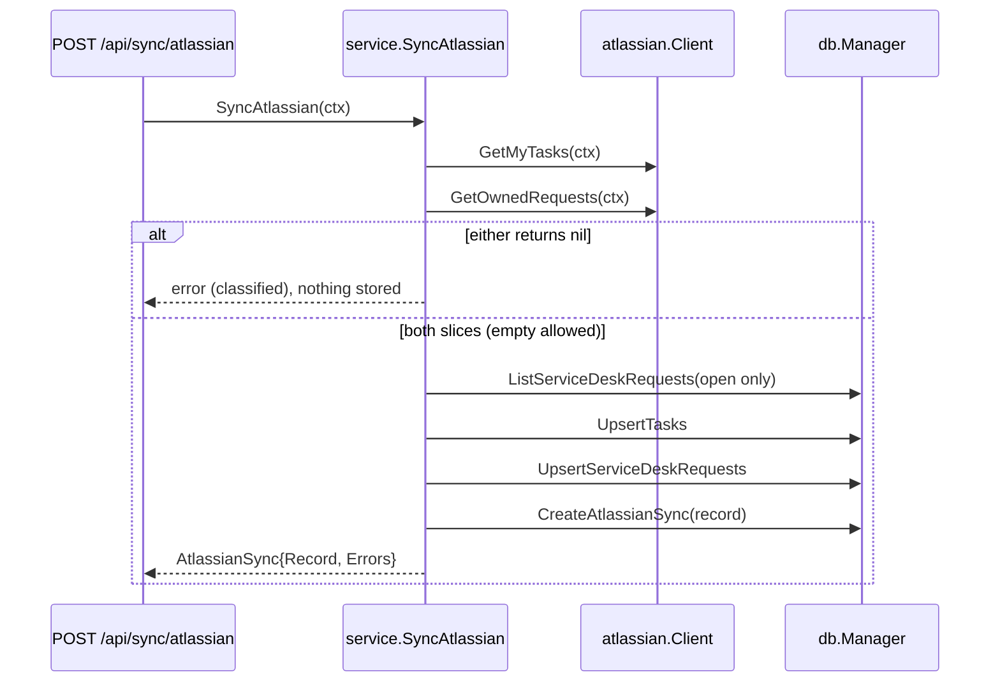

# Service Desk 요청 수집을 붙일 현재 경로와 공식 계약

DEV-21 계획 승인 시점의 코드와, 2026-10-27에 받은 Jira Service Management Cloud OpenAPI(`https://dac-static.atlassian.com/cloud/jira/service-desk/swagger.v3.json`, operation `getCustomerRequests`) 및 JSM REST intro의 base URL 규칙이다.

## 현재 Atlassian 동기화 경로

Jira 이슈와 Service Desk 요청은 웹앱의 `Sync now` 하나로 함께 동기화된다.

- `atlassian.Client` 는 `GetMyTasks`·`GetOwnedRequests`·`GetTask`·`Configure`·`Check` 를 가진다 (`internal/adapter/atlassian/client.go`). 사이트와 Basic·JSON 헤더는 `api{base, header}` 로 묶여 RWMutex 아래에 있고, 웹앱이 설정을 저장하면 `Configure` 로 바뀐다. site URL 이 비면 `ErrNotConfigured` 다. site URL 경로 prefix 는 유지되고 요청 URL 은 `base + requestsPath` 처럼 호출마다 만든다.
- `GetMyTasks` 는 페이지 실패면 `nil, err`, `isLast` 또는 토큰 부재면 모은 task 와 join 된 항목 에러를 반환한다. `GetOwnedRequests` 도 같은 "nil 이면 전체 실패" 규칙이다(아래).
- `httputil.HTTPClient` 는 `Get` 와 `Post` 를 가진다 (`internal/pkg/httputil/httputil.go`). Jira 검색은 `Post`, Service Desk 와 `GetTask`·`Check` 는 `Get` 이다. 2xx 가 아니면 `*httputil.StatusError` 로 상태 코드를 담는다.
- `service.SyncAtlassian` (`internal/service/sync.go`) 은 두 조회가 모두 성공한 뒤에만 저장해, 조회 실패는 아무것도 바꾸지 않는다. `ClosedRequests` 는 저장 전에 열려 있던(`status_category != 'DONE'`) 요청 중 이번에 DONE 으로 받은 수, `OpenRequests` 는 받은 요청 중 DONE 이 아닌 수다. 결과는 `atlassian_syncs` 에 남고 `GET /api/sync/atlassian` 이 마지막 기록을 준다.
- `POST /api/sync/atlassian` (`internal/server/sync.go`) 는 성공 시 `{synced_at, issues, issue_failures, open_requests, closed_requests, request_failures, errors?}` 를 쓴다. Atlassian 에러는 `code` 로 구분된다: 미설정 409 `atlassian_not_configured`, 401/403 502 `atlassian_unauthorized`, 연결 실패 504 `atlassian_unreachable`.
- 열린 요청 목록은 `GET /api/service-desk/requests`(`include_closed=true` 면 전부)다.
- `cmd/wharf/main.go` 가 `httputil.NewHTTPClient()` 와 config 의 site URL·email·token(없으면 빈 값 = 미설정)으로 `atlassian.NewClient` 를 만들어 `service.NewService` 와 `service.NewSettings` 에 같은 인스턴스를 넘긴다.
- 스키마는 `scripts/migrations/0001_initial_migration.sql` 에 있다. 첫 배포 전 스키마 변경은 이 파일만 고친다 (`AGENTS.md`).
- mock 은 `.mockery.yml` 의 `atlassian.Client`, `db.Manager`, `service.Service`, `service.Settings`, `system.Desktop` 이다. 테스트는 외부 패키지 `*_test` 와 `testify/require` 다. `tests/e2e` 디렉터리는 없다.

## 공식 Service Desk 계약

`GET /rest/servicedeskapi/request`. 실험적 메서드가 아니다 (`X-ExperimentalApi` 없음). 응답 코드는 200, 401, 404, 500.

쿼리:

- `requestOwnership=OWNED_REQUESTS` — 호출한 사용자가 만든 요청. 생략하면 `OWNED_REQUESTS` + `PARTICIPATED_REQUESTS` + `ALL_ORGANIZATIONS` 가 기본이다. `requestOwnership=ALL_REQUESTS` 는 deprecated.
- `requestStatus=ALL_REQUESTS` — 열림과 닫힘을 모두 반환한다. 이 값은 deprecated 가 아니다.
- `limit` 기본값 50. `start` 는 0부터. expand 목록에 assignee 는 없다.

페이지 응답: `size`, `limit`, `start`, `isLastPage`, `values`. 다음 페이지의 `start` 는 이전 `start + size` 다. `size` 가 요청한 `limit` 보다 작아도 `isLastPage` 가 false 일 수 있다(서버 상한).

`CustomerRequestDTO` (`additionalProperties: false`) 의 속성: `_expands`, `_links`, `actions`, `attachments`, `comments`, `createdDate`, `currentStatus`, `issueId`, `issueKey`, `participants`, `reporter`, `requestFieldValues`, `requestType`, `requestTypeId`, `serviceDesk`, `serviceDeskId`, `sla`, `status`, `summary`. assignee 와 updated 시각은 없다.

- `summary` 는 문자열이다. 공식 예시는 최상위 `summary` 가 빠진 항목에 `requestFieldValues[].fieldId == "summary"` 를 둔다. 그 `value` 스키마는 타입이 없고, 예시에서는 JSON 문자열이다.
- `currentStatus.status` 는 상태 이름 문자열이다. `currentStatus.statusDate` 는 "Date on which the status was attained" 다.
- `currentStatus.statusCategory` 는 Jira 상태 카테고리(`NEW`·`INDETERMINATE`·`DONE`·`UNDEFINED`)다. 상태 이름은 프로젝트마다 다르므로("Done"·"Canceled"·"Resolved" 등) 닫힌 요청은 이름이 아니라 `DONE` 카테고리로 가른다. `toRequest` 는 이 값을 trim 해 `servicedesk.Request.StatusCategory` 로 옮긴다. 비었거나 필드가 없으면 그 항목을 빼지 않고 `UNDEFINED` 로 둔다 (`internal/adapter/atlassian/servicedesk.go:184`). 빈 status 처럼 항목을 버리면, 어떤 인스턴스·API 버전이 이 필드를 빼는 순간 모든 요청이 부분 실패로 빠지고 기존 행과 todo 연결이 낡기 때문이다. `UNDEFINED` 는 닫힌 요청이 아니므로 Today 에 남는다. 테이블 컬럼은 `service_desk_requests.status_category` 다.
- `createdDate` 와 `statusDate` 는 `DateDTO`: `epochMillis`, `friendly`, `iso8601`, `jira`. 공식 예시의 `iso8601` 은 `2015-10-08T14:42:00+0700` 처럼 타임존 콜론이 없다. `epochMillis` 는 UTC 밀리초다.
- `reporter` 는 `UserDTO` (`displayName` 등)이고 요청을 올린 고객이다. 담당 에이전트가 아니다.

Base URL (JSM REST intro):

- Basic: `https://{site}.atlassian.net/rest/servicedeskapi/`
- OAuth 3LO 및 scoped token 게이트웨이: `https://api.atlassian.com/ex/jira/{cloudId}/rest/servicedeskapi/` (`{api}` 예시가 `/rest/servicedeskapi/request`).

인증은 Jira Cloud 와 같다. 이 저장소는 `Authorization: Basic base64(email:token)` 을 이미 만든다 (`client.go:52`).

## todo 와의 relates-to 연결

연결은 처음(DEV-22)에는 task 와 요청 사이였다. 웹앱 디자인(`docs/design`)이 Inspector 에서 todo 마다 요청을 붙이고, 요청 Inspector 에서 연결된 todo 를 보여주므로 연결 대상을 todo 로 옮겼다(DEV-25). 쓰기 규칙과 API 모양은 task 때와 같다.

- 스키마: `todo_service_desk_requests (todo_id INTEGER, issue_key, PRIMARY KEY (todo_id, issue_key))` (`scripts/migrations/0001_initial_migration.sql:86`, 배포 전 예외로 0001 에 직접 둔다). 행 하나가 방향 없는 연결 하나이고 다대다다. FK·추가 인덱스는 없다(PK 가 `todo_id` 조회를 덮는다).
- API: `PUT /api/todos/{id}/service-desk-requests/{key}` → 204(멱등, 다시 PUT 해도 204·행 하나), todo 없음·요청 없음은 각각 404, 정수가 아닌 todo id 도 404. `DELETE /api/todos/{id}/service-desk-requests/{key}` → 204, 연결이 없으면 404. 본문은 없다 (`internal/server/route.go`).
- `GET /api/todos` 의 todo 마다 `service_desk_requests` 배열(`{"key","title","status","status_category","created_at","status_at"}`, `issue_key` 오름차순, 없으면 `[]`)이 붙는다. `ListTodoServiceDeskRequests` 는 `ListTodoReminders` 처럼 `ListTodos` 필터를 그대로 받아 같은 todo 들의 연결만 한 번에 JOIN 해 읽는다(바인드 변수 수가 todo 수와 무관). `GET /tasks/{id}` 에는 요청이 더 이상 붙지 않는다.
- 연결은 wharf 소유다. `UpsertTasks`(Jira 동기화)·`UpsertServiceDeskRequests`·`UpdateTodo`(다른 task 로 이동 포함)는 연결을 건드리지 않는다. `DeleteTodo` 는 그 todo 의 연결 행을, `DeleteTask` 는 그 task 에 속한 todo 들의 연결 행을 같은 트랜잭션에서 지운다(`task_todos` 로 찾으므로 `task_todos` 행보다 먼저). 동기화가 요청 행을 지우지 않으므로 요청 쪽 cascade 는 없다. Jira 쪽(issue link)에는 연결을 쓰지 않는다.
- 계층: `db.Manager.LinkServiceDeskRequest(ctx, todoID, key)`·`UnlinkServiceDeskRequest(ctx, todoID, key)` (`internal/adapter/db/client.go:354`·`:405`) 와 `ListTodos` 가 채우는 `todo.Todo.ServiceDeskRequests` → `service.LinkServiceDeskRequest`·`UnlinkServiceDeskRequest` (`internal/service/service.go:215`·`:231`, sentinel `ErrTodoToLinkNotFound`·`ErrServiceDeskRequestToLinkNotFound`·`ErrServiceDeskRequestLinkToDeleteNotFound`) → 핸들러는 `internal/server/todo.go` 에 있다.
