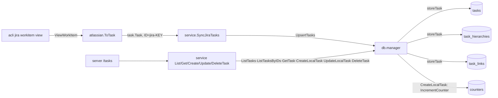

# Task ID 와 관계(parent/children/linked) 저장 구조

DEV-17 에서 관계를 `tasks` 의 JSON 컬럼에서 별도 테이블로 옮기고 ID 를 `{originated}-{key}` 로 바꿨다. 결정 근거는 [DEV-17 plan](../dev/20261025134928_DEV-17_PLAN_task-db-improvement.md) 의 Key decisions 에 있다. DEV-16 에서 task API(목록·상세·생성·수정·삭제)와 읽기 쿼리, cross-origin parent 규칙이 추가됐다([DEV-16 plan](../dev/20261025143450_DEV-16_PLAN_task-api.md)).

## 구조 요약

- 도메인 타입 `task.Task` (`internal/pkg/task/task.go:5-16`) 는 바뀌지 않았다: `ID`, `Originated`, `ParentID`, `ChildrenIDs`, `LinkedIDs` 등.
- 스키마 `scripts/migrations/0001_initial_migration.sql`:
  - `tasks`: 관계 컬럼 없이 `id, originated, title, description, status, start_date, due_date`.
  - `task_hierarchies (child_id PK, parent_id)`: child_id 가 PK 라 task 의 parent 는 하나다.
  - `task_links (task_id, linked_id, PK(task_id, linked_id))`: 선언한 task 기준의 방향 있는 행. 양방향 조회는 읽기 쿼리에서 합집합으로 해야 한다.
  - `counters (name PK, value)`: `('local_task', 0)` 을 seed 한다. 이름 문자열은 `internal/adapter/db/client.go:30` 의 `localTaskCounter` 와 같아야 한다.
  - 관계는 DB 에 없는 task 를 가리킬 수 있어 `tasks(id)` FK 가 없다. 조회용 인덱스 `task_hierarchies_parent_id`(`task_hierarchies(parent_id)`), `task_links_linked_id`(`task_links(linked_id)`) 가 있다(DEV-16, 0001 에 직접 추가 — 기존 로컬 `wharf.db` 는 다시 만들어야 한다).
- 쿼리 `scripts/queries.sql`:
  - 쓰기: `UpsertTask`, `DeleteTaskParent`, `DeleteTaskNonLocalParent` (parent 가 `tasks.originated = 'local'` 인 행은 남김), `DeleteTaskChildren` (`parent_id = ?`), `UpsertTaskHierarchy` (`ON CONFLICT(child_id) DO UPDATE`), `DeleteTaskLinks`, `CreateTaskLink` (`ON CONFLICT DO NOTHING`), `UpdateLocalTask` (`:execrows`, `WHERE id = ? AND originated = 'local'`), `DeleteTask` (`:execrows`), `DeleteTaskHierarchies` (child·parent 양쪽), `DeleteTaskLinksOf` (선언자·대상 양쪽), `IncrementCounter` (`UPDATE ... RETURNING value`, `:one`), 마이그레이션용 2개.
  - 읽기: `ListTasks` (id 순), `ListTasksByIDs` (`sqlc.slice`, 빈 slice 는 `IN (NULL)` 로 0행), `GetTask` (`sqlc.embed(tasks)` + `LEFT JOIN task_hierarchies` 로 parent 를 함께, `GetTaskRow{Task, ParentID sql.NullString}`), `ListTaskChildren`, `ListTaskLinks` (`task_id = ?` 와 `linked_id = ?` 의 `UNION`, 중복 제거·id 순. sqlc 가 `ORDER BY 1` 과 테이블 미지정 컬럼에서 "ambiguous" 로 실패해서 `AS id` 별칭과 `task_links.` 한정이 필요했다).
- sqlc 생성 코드는 `make gen` 으로만 재생성한다. `make modelgen` 은 sqlc 를 설치하지 않으므로 `go install github.com/sqlc-dev/sqlc/cmd/sqlc@v1.31.1` 이 필요할 수 있다. Go 1.27 모듈이라 mockery·golangci-lint 도 go1.27 이상으로 빌드된 것이어야 한다(`GOTOOLCHAIN=go1.27.3 go install ...`).

## ID 가 만들어지는 곳

- `task.NewID(originated, key)` (`internal/pkg/task/id.go:10`) 가 `{originated}-{key}` 를 만든다. `task.LocalKey(n)` (`:16`) 은 `WHF-%03d` (3자리 0 채움, 999 초과 시 자리수 증가).
- Jira: `atlassian.ToTask` (`internal/adapter/atlassian/jira.go:57`) 가 task 자신(`:99`), parent(`:77`, 빈 key 면 parent 없음), children, linked 모두에 `jira-` 접두어를 붙인다. 관계 ID 가 저장된 task ID 와 맞물려야 하기 때문이다. `atlassian.client` 의 CLI 호출(`JiraViewOption(key)`)과 에러 메시지의 `key=` 는 raw key 를 쓴다.
- local: `db.Manager.CreateLocalTask` (`internal/adapter/db/client.go:115`) 가 한 트랜잭션에서 카운터를 올리고 `local-WHF-NNN` ID 로 task 와 관계를 저장한 뒤 ID 를 돌려준다. 입력의 `ID`, `Originated` 는 무시한다. 실패하면 카운터 증가도 롤백되어 번호가 소모되지 않는다. `service.CreateTask` → `POST /tasks` 가 호출한다.
- 접두어 `WHF` 는 상수 `localKeyPrefix` 로 유지한다(DEV-16 결정: 바꾸면 기존 task 와 접두어가 섞이고 카운터는 하나라 TOML 로 옮겨 얻는 것이 없다).

## 관계 쓰기 소유 규칙 (`storeTask` `client.go:289` → `storeRelations` `client.go:299`)

`UpsertTasks` 와 `CreateLocalTask` 는 `storeTask`(upsert + `storeRelations`), `UpdateLocalTask` 는 `storeRelations` 를 쓴다. task T 를 저장할 때:

- parent 는 T(child) 소유: `child_id = T` 행을 지우고 `ParentID` 가 있으면 `(T, ParentID)` 를 넣는다. 예외(DEV-16): T 가 local 이 아니고 parent 를 선언하지 않으면 `DeleteTaskNonLocalParent` 로 local parent(`tasks.originated = 'local'` 인 parent) 행은 남긴다. local parent 는 `CreateLocalTask`·`UpdateLocalTask` 만 선언하고 `DeleteTask` 가 그 행을 지우므로 항상 저장되어 있다. 그래서 local task 가 Jira task 를 child 로 묶은 관계가 동기화에도 유지된다. Jira task 가 parent 를 선언하면 그 parent 로 교체된다(parent 는 하나, Jira 가 이긴다).
- children 은 추가·재지정만: 각 child 에 `(child, T)` 를 upsert 해 다른 parent 에 있던 child 를 T 로 옮긴다. T 의 다른 children 행은 지우지 않는다.
- links 는 T 가 선언한 행만 교체: `task_id = T` 행을 지우고 `LinkedIDs` 를 넣는다. 다른 task 가 T 로 선언한 행은 남는다.
- 중복된 children/links 는 한 행으로 저장된다.
- `UpdateLocalTask`(PUT) 는 예외로 children 을 전체 교체한다: `parent_id = T` 행을 모두 지운 뒤 선언한 children 을 넣는다. links 도 양방향 전체 교체다: `DeleteTaskLinksOf` 로 `task_id = T`·`linked_id = T` 행을 모두 지운 뒤 `T > linked` 로 넣는다. `GetTask` 가 links 를 양방향 합집합으로 읽으므로, GET 결과를 그대로 PUT 해도 역방향 행이 복제되지 않고 PUT 으로 역방향 링크도 지울 수 있다. 지워진 Jira 쪽 선언 링크는 그 Jira task 의 다음 동기화에서 다시 생긴다. PUT 은 빠진 필드를 빈 값으로 보는 전체 교체이므로, 클라이언트는 GET 의 `parent_id`·`children_ids`·`linked_ids` 를 모두 다시 보내야 관계가 유지된다(부분 수정이 필요해지면 별도 PATCH 로 다룬다).
- `DeleteTask` 는 T 의 행과 T 가 child·parent·선언자·대상인 관계 행을 지우고 다른 task 는 건드리지 않는다.

근거:

- Jira `subtasks` 는 sub-task 유형만 담아서 Epic 은 Story 를 children 으로 선언하지 않는다. parent 쪽에서 children 을 통째로 교체하면 Story(parent=Epic) 저장 뒤 Epic 저장 시 관계가 지워진다.
- Jira `issuelinks` 는 양쪽 issue 에 모두 나오고, 같은 상대와 여러 link type 으로 연결되면 같은 key 가 두 번 나온다.
- local task 가 Jira task 로 선언한 링크는 Jira 쪽이 모르므로, Jira task 재동기화 때 지워지지 않아야 한다.

알려진 한계(수락된 위험):

- 동기화되지 않는 task 쪽의 오래된 관계는 정리되지 않는다.
- 같은 배치 안에서 `[P(children=[C]), C(parent 없음)]` 와 `[C, P]` 의 결과가 순서에 따라 다르다(나중 선언이 이긴다).
- (DEV-16 에서 해소) local task 가 Jira task 를 child 로 선언한 행은 위 예외로 동기화 후에도 남는다. local parent 판별은 ID 접두어가 아니라 `tasks.originated` 컬럼으로 한다.
- 관계 cycle·`parent_id` 와 `children_ids` 의 모순은 검증하지 않는다. 자기 참조만 `service.UpdateTask` 가 막는다.

## SQLite 트랜잭션 제약

- `db.Connect` 는 `busy_timeout(5000)` 을 붙이고 연결을 1개로 제한한다 (`internal/adapter/db/client_management.go`, `busyTimeoutPragma` 주석). `BeginTx` 는 DEFERRED 라 "읽고 나서 쓰는" 트랜잭션은 다른 프로세스와 경합 시 즉시 SQLITE_BUSY 가 난다. 그래서 트랜잭션은 쓰기로 시작한다.
- `CreateLocalTask` 는 `IncrementCounter`, `UpdateLocalTask` 는 `UpdateLocalTask` 쿼리, `DeleteTask` 는 `DeleteTask` 쿼리를 첫 문장으로 실행해 이 규칙을 지키고, 존재 여부는 영향 행 수(0 이면 `ErrLocalTaskToUpdateNotFound`/`ErrTaskToDeleteNotFound`)로 판별한다. 읽기(`ListTasks`, `GetTask` 등)는 트랜잭션 없이 실행한다. `SELECT MAX(...)+1` 은 읽기로 시작하고, 마지막 task 삭제 시 번호를 재사용하므로 쓰지 않았다.
- 카운터 행이 없으면 `RETURNING` 이 행을 돌려주지 않아 `sql.ErrNoRows` 가 되고 `ErrFailedToIncrementLocalTaskCounter` 로 드러난다.

## ID 와 관계 테이블에 의존하는 테스트

- `internal/adapter/atlassian/jira_test.go` `TestToTaskRelations`: ID·ParentID·ChildrenIDs·LinkedIDs 의 `jira-` 접두어와 빈 key 처리. 에러 메시지의 `key=WHF-1` 은 raw key.
- `internal/adapter/db/client_test.go`: `read` 헬퍼(`:90`)·`open`(`:145`)·`relations` 로 파일 DB 에 별도 연결해 직접 SQL 로 확인한다. `TestInitialMigrationSchema`(`:159`), `TestInitialMigrationIndexes`(`:493`), 관계 소유 규칙 테스트(`:257-334`), `TestUpsertTasksRollsBackOnFailure`(`:335`, RAISE trigger 로 쓰기 지점별 실패 유도), `TestCreateLocalTask*`(`:422-`), cross-origin parent `TestUpsertTasksKeepsLocalParentOfJiraTask`(`:520`), 읽기·수정·삭제 `TestListTasks`~`TestDeleteTask`(`:544-`).
- `internal/service/service_test.go`, server 테스트는 ID 를 불투명 문자열로만 쓴다(server 의 `Location` 은 `/tasks/{id}`).
